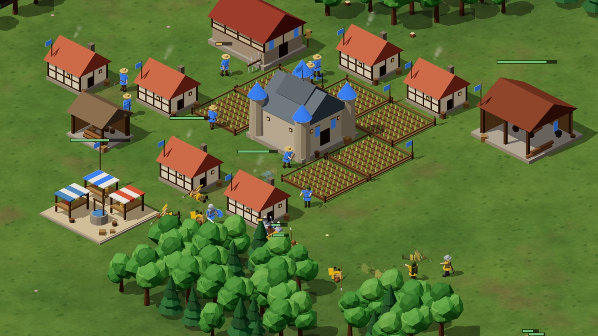
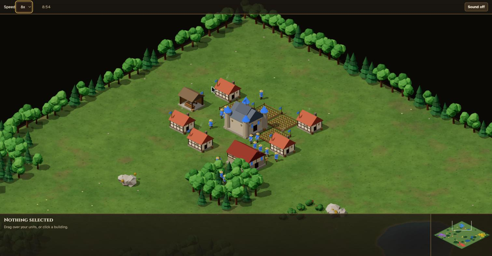
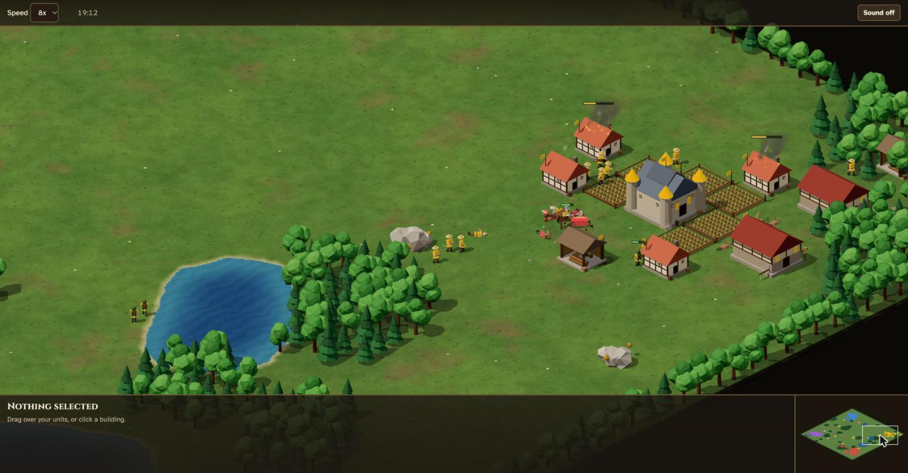
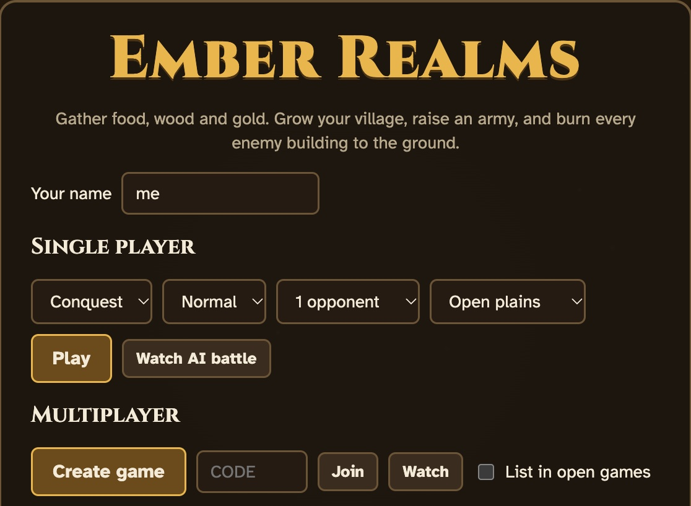
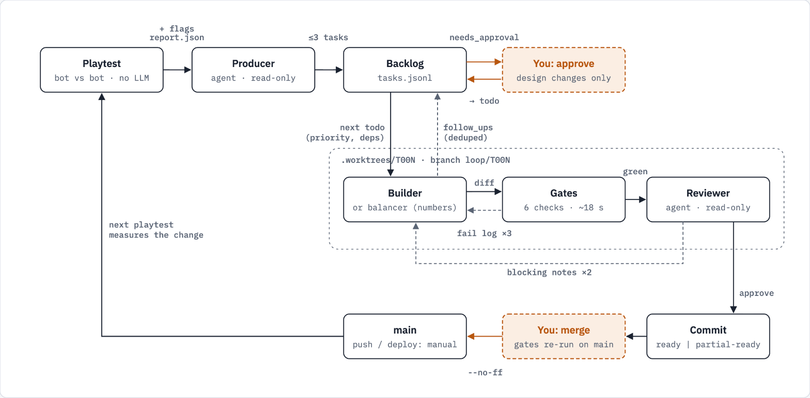

# Ember Realms

**A real-time strategy game you play in the browser.** Build a village, raise an army, and burn every enemy building to the ground. No install, no account.

**[▶ Play now at rts.codewithpeter.com](https://rts.codewithpeter.com)** · [Game guide](docs/GAME-GUIDE.md) · [How it works](docs/ARCHITECTURE.md) · [AI dev loop](loop/README.md)



## What is it?

Ember Realms is an original RTS that I built as a live example for my Event Driven Programming course at [akademiata.pl](https://akademiata.pl). A strategy game is full of events: a unit is trained, a building is finished, an attack starts, a player loses. The game sends all of them to a message broker, so students can build their own services on a real, running system instead of a toy example.

It is also a real game, and a fun one :)

- **Play alone** against 1 to 3 computer players (easy, normal or hard), or **with friends** (2 to 4 players, empty seats can be computer players) using a room code or an invite link
- **4 maps:** Lakes, Open plains, Black forest and River crossing
- **8 kinds of units**, two ages, walls, gates, towers, a market and upgrades
- **Teams**, chat, map pings and spectators
- **Peaceful mode** if you just want to build
- **Watch the AI fight itself** at up to 8x speed
- **Replays** of every game, with stats and charts at the end
- Original low-poly 3D art and sound made in code: no asset packs

| Your village grows | Siege of an enemy town | The menu |
|---|---|---|
|  |  |  |

## How to play

1. **Gather.** Villagers collect food (berries, then farms), wood (trees) and gold (mines). They carry it back to the Town Centre. A Storehouse is a closer drop-off for wood and gold.
2. **Build.** Houses give +5 population. Barracks train soldiers, farms give food when the berries run out.
3. **Train an army.** Every unit is strong against some units and weak against others:

    | Unit | Strong against | Weak against |
    |------|----------------|--------------|
    | Swordsman | spearmen, buildings | archers, cavalry |
    | Spearman | cavalry, rams | archers, swordsmen |
    | Archer | spearmen | cavalry |
    | Cavalry | archers, rams | spearmen |
    | Knight (Castle Age) | archers, crossbowmen, rams | spearmen |
    | Crossbowman (Castle Age) | spearmen | cavalry, knights |
    | Battering ram | buildings | any melee unit |

4. **Advance to the Castle Age** at the Town Centre for knights, crossbowmen, rams, towers and the market.
5. **Win.** A player is out when all their buildings are destroyed. The last player (or team) standing wins.

Every rule, number and AI behaviour is in the **[game guide](docs/GAME-GUIDE.md)**.

### Controls

| Do this | How |
|---|---|
| Select units | left-click, or drag a box |
| Move, gather, build, attack | right-click |
| Build, train or research | Q W E R T Y U I O |
| Attack-move | A, then click |
| Stance: aggressive / defensive / stand ground | Z / X / C |
| Stop | S |
| Find an idle villager / your Town Centre | `.` / H |
| Control groups | Ctrl+1–9 to set, 1–9 to select, twice to jump there |
| Chat / team chat | Enter / Shift+Enter |
| Ping the map for your allies | G, or Alt+click |
| Move the camera | arrow keys, screen edges, or click the minimap |
| Send selected units somewhere far | right-click the minimap |
| Zoom | mouse wheel |

## Run it on your computer

You need [Node.js](https://nodejs.org) 18 or newer.

```bash
git clone https://github.com/pbrudny/edp-rts.git
cd edp-rts
npm install
npm start
```

Then open http://localhost:3000. Events are only sent to a broker when `BROKER_URL` is set, so the game runs fine without one.

Check that everything works:

```bash
node loop/gates.mjs        # all automatic checks, about 20 seconds
node test-sim.mjs normal hard   # one headless AI-vs-AI game in the terminal
```

## For students: the events

The server publishes these events to the broker topic `demo.rts`:

`game_started` · `building_placed` · `building_completed` · `unit_trained` · `tech_researched` · `unit_killed` · `building_destroyed` · `attack_launched` · `player_defeated` · `game_over`

Ideas for your own consumer: a live leaderboard, a Slack bot that announces battles, a dashboard of resources over time, or an alert when someone is about to lose. How the server, the game rules and the browser fit together is in **[How it works](docs/ARCHITECTURE.md)**.

## How it is developed: AI agents, people in charge

The game rules are deterministic: the same start and the same commands always give the same game. So the computer can play many games on its own, in about a second each. I used that to build a development loop with AI agents. A tester plays 50 games and collects numbers, a planner turns problems into small tasks, a builder writes the code, automatic checks and a reviewer decide if it is good enough. I approve bigger changes and merge.



The details are in [loop/README.md](loop/README.md). The story is in my article [AI Writes the Code, People Stay in the Loop (Part 1)](https://medium.com/@pbrudny/ai-writes-the-code-people-stay-in-the-loop-part-1-209f9d4be7da). The next step, a game the players build themselves, is [Evolvia](https://github.com/pbrudny/evolvia).

## Project layout

```
shared/sim.js     all game rules and the AI (used by the server and the browser)
server.js         HTTP + WebSocket server, rooms, replays, events to the broker
public/           the browser game: renderer, input, menus, sound
baker/            low-poly 3D models, rendered into the sprite sheets in public/assets
test-*.mjs        rule tests, replay test, multiplayer test
loop/             playtests, automatic checks and the AI agent loop
docs/             game guide, architecture, screenshots
```

## Author

Made by [Piotr Brudny](https://github.com/pbrudny). Ideas, bugs and questions are welcome in [Issues](https://github.com/pbrudny/edp-rts/issues).
